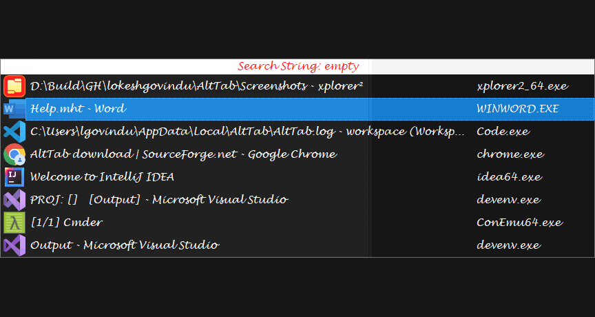
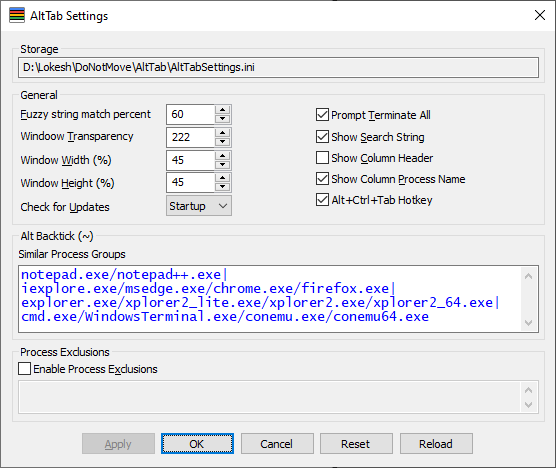
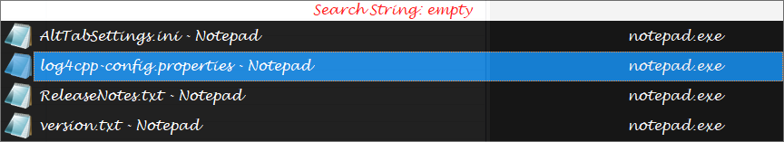
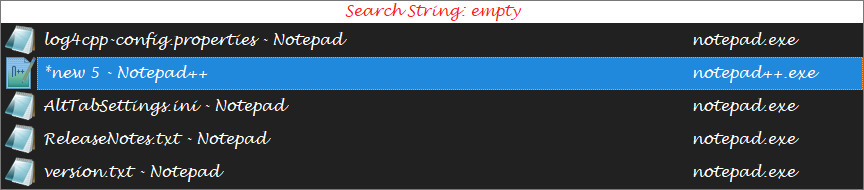
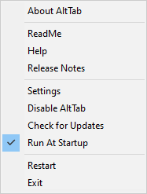

# AltTab
AltTab is a small application created in C++, Win32, is an alternative for windows native task switcher (Alt+Tab / Alt+Shift+Tab). 

The original author, Lokesh Govindu, decided to take it closed-source so this fork is based on a slightly older version that I have
bug fixed mostly using AI. His closed-source version can be found [on Sourceforge](https://sourceforge.net/projects/alttab/)

# Features
* Find the right window faster (filter windows using search string), uses fuzzy string matching algorithm (no need to type the exact search string).
* Switch between windows of the same application using Alt + \` (Grave Accent / Backtick, the key right above the Tab on a US English keyboard layout).
* Terminate a process or all processes either normally or forcefully using keyboard shortcuts.
Hide / Un-hide windows.
* Provided configuration/setting INI file & UI to change font style, background color, window transparency, width and height.

## Screenshots
### AltTab main window

### AltTab Settings

### AltBacktick

### AltBacktick with SimilarProcessGroups

### ContextMenu

### TrayMenu

